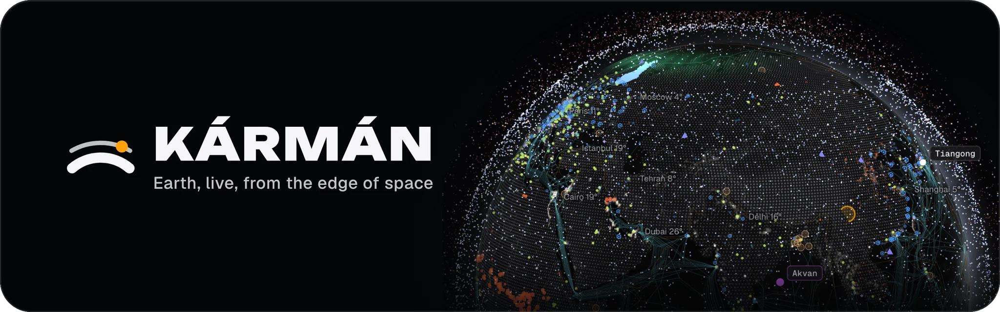
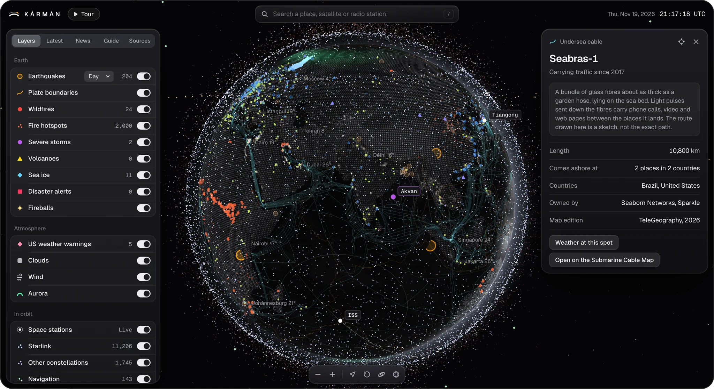

<p align="center">
  
</p>

<p align="center">
  <a href="https://jyotirdev.github.io/karman/"><b>Open the live globe</b></a>
  &nbsp;·&nbsp; <a href="#whats-on-the-globe">What's on it</a>
  &nbsp;·&nbsp; <a href="#run-it">Run it</a>
  &nbsp;·&nbsp; <a href="#data-and-credits">Data and credits</a>
  &nbsp;·&nbsp; <a href="#licences">Licences</a>
</p>

<br>

**Kármán is a live 3D globe of what is happening on the planet right now.** Earthquakes as they are located, storms and fires as satellites see them, every tracked object in orbit, the aurora, rocket launches, world news, radio you can tune into, roadside cameras you can look through, the cables that carry the internet and every nuclear power station on record.

It is **one HTML file**. No server, no account, no API key, no tracking. Your browser asks each public data provider directly and draws what comes back.

The name is the Kármán line: 100 km up, where the sky is said to end and space to begin. This is the planet as seen from there.

<p align="center">
  
</p>

## What's on the globe

37 layers in six groups. Each can be switched on or off, and every marker explains itself in plain words when clicked.

| Group | Layers |
|---|---|
| **Earth** | Earthquakes, plate boundaries, wildfires, fire hotspots, severe storms, volcanoes, sea ice, disaster alerts, fireballs |
| **Atmosphere** | Clouds, wind, aurora, US weather warnings |
| **In orbit** | Space stations, Starlink, other constellations, navigation, geostationary, every other satellite, debris, spent rocket stages, dead satellites, launches, deep space antennas |
| **People and nature** | Cities and weather, news, wildlife sightings, radio stations, wild sounds, live cameras |
| **Infrastructure** | Nuclear facilities, undersea internet cables |
| **Map** | Borders, NASA satellite views (rain, sea temperature, snow and ice, haze, air pollution, true colour), city lights, grid |

**Things to try**

- **Take the tour.** Press <kbd>T</kbd>. The globe flies itself round every notable event happening now, with a caption at each stop and music made in the browser as it plays.
- **Click anywhere.** Any point on land or sea opens its weather, local time, air quality, country facts and what is happening nearby.
- **Look through a camera.** Live video in California, a clip from the last few minutes in London, the past day replayed in Finland, a fresh picture every minute in Singapore.
- **Tune the radio.** Click a station and listen live, or let it scan from country to country.
- **Follow a cable or open a reactor.** Every undersea cable and nuclear site has a card: who owns it, how old it is, what it does.
- **Search.** Press <kbd>/</kbd> for a city, a country, a satellite, a radio station, a cable or a nuclear site.

<details>
<summary><b>Keyboard</b></summary>

<br>

| Key | Does |
|---|---|
| <kbd>/</kbd> | Search |
| <kbd>T</kbd> | Start the tour |
| <kbd>Space</kbd> or <kbd>K</kbd> | Pause the tour |
| <kbd>←</kbd> <kbd>→</kbd> | Previous or next stop |
| <kbd>,</kbd> <kbd>.</kbd> | Slower or faster tour |
| <kbd>M</kbd> | Tour music on or off |
| <kbd>F</kbd> | Full screen, in the tour |
| <kbd>Esc</kbd> | Close the open card, or leave the tour |

</details>

## Run it

Nothing to install. The app is [`index.html`](index.html): open it from disk, or serve the folder.

```bash
python3 -m http.server 8080      # then visit http://localhost:8080
```

To host it, put `index.html` on any static host.

- **GitHub Pages:** Settings → Pages → Deploy from a branch → `main`, `/ (root)`.
- **Netlify:** connect the repository, or drag the folder onto the dashboard. [`netlify.toml`](netlify.toml) is included.

Add `#tour` to the address to start in tour mode.

## Build it

The source is in [`src/`](src). One script with no dependencies assembles it into the single file.

```bash
node tools/build.js              # src/ + assets/  →  index.html
```

<details>
<summary><b>Project layout</b></summary>

```
karman/
├── index.html             the built app: everything in one file
├── src/
│   ├── index.html         page shell
│   ├── style.css          all styles
│   └── app/               the program, joined in name order
│       ├── 00-core.js       helpers, layer registry, storage
│       ├── 10-scene.js      the globe: shaders, markers, lines, picking
│       ├── 30-ui.js         panels, cards, sources, guide
│       ├── 40 … 85          one file per family of feeds
│       ├── 86-open.js       the opening sequence
│       ├── 87-music.js      generative tour music (Web Audio)
│       ├── 88-tour.js       tour mode
│       └── 90-main.js       wiring, scheduler, frame loop
├── AGENTS.md              instructions for AI coding agents
├── .claude/               Claude Code settings, rules and skills
├── assets/                map data embedded at build time
├── data/                  raw inputs for the two built-in datasets
├── tools/                 build script and data preparation
├── tests/                 headless smoke tests with stand-in feeds
└── docs/                  architecture notes, brand, screenshots
```

</details>

How the pieces fit is in [docs/ARCHITECTURE.md](docs/ARCHITECTURE.md). To change something and send it back, see [CONTRIBUTING.md](CONTRIBUTING.md).

## How it works

- **One file.** Styles, program and map data are inlined. three.js and satellite.js load from public CDNs; the video player for camera streams loads only when one is opened.
- **No backend.** Every feed is a public endpoint that answers browsers directly and needs no key. Requests go from the visitor's browser to the provider and nowhere else.
- **Built to degrade.** Each source reports its own state in the Sources tab. Many have a backup provider or a saved copy, and one failing never stops the rest. The cable map and the reactor list are built in, so they draw with no connection at all.
- **Orbits in the browser.** The position of every tracked satellite is computed from its orbital elements with SGP4 in a web worker.
- **A renderer made for data.** Land is a field of dots on a monochrome globe, so colour is kept for what is happening. One draw call per layer keeps tens of thousands of markers smooth.

## Data and credits

Kármán exists because these organisations publish their data openly. Thank you to every one of them.

| For | Published by |
|---|---|
| **Earth** | [USGS](https://earthquake.usgs.gov/) · [EMSC](https://www.seismicportal.eu/) · [NASA EONET](https://eonet.gsfc.nasa.gov/) · [GDACS](https://www.gdacs.org/) · [kanari.io](https://kanari.io/) · [NASA JPL CNEOS](https://cneos.jpl.nasa.gov/) |
| **Atmosphere and Sun** | [Open-Meteo](https://open-meteo.com/) · [MET Norway](https://api.met.no/) · [US National Weather Service](https://www.weather.gov/) · [NOAA SWPC](https://www.swpc.noaa.gov/) · [GFZ Potsdam](https://kp.gfz-potsdam.de/) · [NASA SDO](https://sdo.gsfc.nasa.gov/) · [NASA GIBS](https://www.earthdata.nasa.gov/engage/open-data-services-software/earthdata-developer-portal/gibs-api) · [EUMETSAT via live cloud maps](https://github.com/matteason/live-cloud-maps) · [NOAA GML](https://gml.noaa.gov/) via [global-warming.org](https://global-warming.org/) |
| **Orbit and spaceflight** | [CelesTrak](https://celestrak.org/) · [SatNOGS](https://db.satnogs.org/) · [wheretheiss.at](https://wheretheiss.at/) · [Launch Library 2](https://thespacedevs.com/llapi) · [NASA DSN Now](https://eyes.nasa.gov/apps/dsn-now/) · [NASA EPIC](https://epic.gsfc.nasa.gov/) · [Spaceflight News API](https://spaceflightnewsapi.net/) |
| **News and places** | [Wikipedia](https://www.wikipedia.org/) · [Wikimedia Commons](https://commons.wikimedia.org/) · [OpenStreetMap](https://www.openstreetmap.org/copyright) · [BigDataCloud](https://www.bigdatacloud.com/) · [Statistics of the World](https://statisticsoftheworld.com/) · [Flagpedia](https://flagcdn.com/) · [Frankfurter](https://frankfurter.dev/) · [ExchangeRate-API](https://www.exchangerate-api.com/) · [caldays](https://caldays.com/) · [Nager.Date](https://date.nager.at/) · [Macrostrat](https://macrostrat.org/) · [GeoJS](https://www.geojs.io/) · [ipwho.is](https://ipwho.is/) |
| **Life and sound** | [iNaturalist](https://www.inaturalist.org/) · [GBIF](https://www.gbif.org/) · [Radio Browser](https://www.radio-browser.info/) |
| **Cameras** | [Fintraffic Digitraffic](https://www.digitraffic.fi/en/road-traffic/) · [Transport for London](https://tfl.gov.uk/info-for/open-data-users/) · [LTA Singapore](https://data.gov.sg/) · [Caltrans](https://quickmap.dot.ca.gov/) |
| **Infrastructure** | [TeleGeography Submarine Cable Map](https://www.submarinecablemap.com/), as cleaned by [Tristan Hotham](https://github.com/Tristan-Hotham/submarine-cables) · [IAEA PRIS](https://pris-stats.iaea.org/) via [GeoNuclearData](https://github.com/cristianst85/GeoNuclearData) · [Wikidata](https://www.wikidata.org/) |
| **Base map** | [Natural Earth](https://www.naturalearthdata.com/) · [NASA Earth Observatory](https://earthobservatory.nasa.gov/features/NightLights) · Peter Bird (2003) via [Hugo Ahlenius](https://github.com/fraxen/tectonicplates) |
| **Software** | [three.js](https://threejs.org/) · [satellite.js](https://github.com/shashwatak/satellite-js) · [hls.js](https://github.com/video-dev/hls.js) · [Geist](https://vercel.com/font) |

What each one provides, where a backup steps in, and the terms it comes under are set out in **[NOTICE.md](NOTICE.md)**.

## Licences

- **The code is MIT.** See [LICENSE](LICENSE). Use it, change it, ship it.
- **The data is not.** Each dataset keeps the licence its publisher gave it. Two travel inside this repository and inside `index.html`:
  - the **cable map** is CC BY-NC-SA 4.0: credit TeleGeography, stay non-commercial, share alike;
  - the **reactor list** is under the Open Database License: credit the source, share changes to the database alike.
- **Planning commercial use?** Remove the cable layer or license it from TeleGeography, and check the terms of the live feeds you rely on. Open-Meteo's free service, for one, is for non-commercial use.

## Good to know

- **Privacy.** No server of its own, no cookies, no analytics. Layer choices and a saved copy of a few feeds stay in your browser. Each provider sees the requests your browser sends it. Your approximate location is looked up only if you press "Go to my area".
- **Reactor statuses** are as recorded in March 2024, the latest open edition of that list.
- **Cable routes** are schematic, as on the source map.
- **Cameras** are those that road agencies publish as open data. None are private.
- **Blocked feeds.** Some networks and ad blockers stop individual providers. The Sources tab shows which answered.
- **Browsers.** Needs WebGL. Current Chrome, Edge, Firefox and Safari work, on desktop and phone.

## Contributing

Ideas, fixes and new layers are welcome. One rule shapes everything: a source must be public, need no key, answer browsers directly and come from a publisher people can trust. The rest is in [CONTRIBUTING.md](CONTRIBUTING.md).

**Working with an AI agent?** The repository is set up for it. [AGENTS.md](AGENTS.md) holds the project's rules in the format coding agents read, and [`.claude/`](.claude) adds path-scoped rules and three workflows for Claude Code: `/add-layer`, `/verify` and `/release`.

<br>

<p align="center">
  <br>
  <sub>Kármán · Earth, live, from the edge of space · MIT</sub>
</p>
